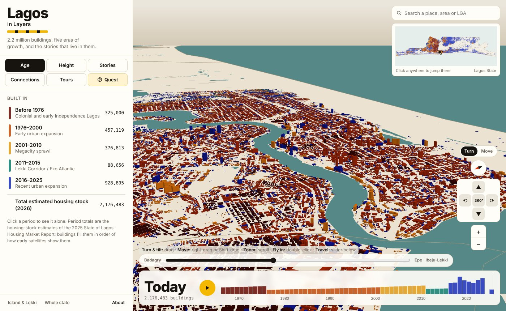

# Lagos in Layers: Every Building in Lagos State in 3D

> All 2,176,483 buildings in Lagos State in 3D, coloured by the period they were built and by height, set in sourced history layers, with a street-level panorama and a quiz. Built entirely from open data and rendered in the browser.

**▶ Live Demo:** [lagos-in-layers-1.vercel.app](https://lagos-in-layers-1.vercel.app/) · **Case study:** [progress-akpan-portfolio.vercel.app/projects/lagos-in-layers](https://progress-akpan-portfolio.vercel.app/projects/lagos-in-layers/)

[](https://lagos-in-layers-1.vercel.app/)

A personal, non-commercial project by **Progress Peter Akpan**, inspired by Alex Barakov's *LAYRS: Amsterdam* and Sasha Bogachev's *Paris, building by building*.

## Overview

Amsterdam and Paris have open registers recording when every building was built, and both have been turned into 3D maps. Lagos has no such register. This project builds the Lagos equivalent from open satellite and mapping data: every footprint in the state is extruded to its estimated height and placed in one of five development periods, from colonial and early-independence Lagos to the post-2016 boom along the Lekki corridor and at Eko Atlantic. Period totals match the housing-stock estimates in the *2025 State of Lagos Housing Market Report*. On top sit sourced history layers: Old Eko, the Brazilian Quarter, the Badagry slave route, the Independence era, Fela's Lagos, Makoko and the water city, land reclaimed from the lagoon, and the new edge of the city.

## Problem statement

Where and when a city grew is basic evidence for housing policy, infrastructure planning, flood-risk work and heritage protection. In Lagos that evidence is scattered: there is no public register of construction years, heights are mapped for only a fraction of buildings, and the open building datasets arrive as tens of gigabytes of raw files. Even with the data, two million buildings are too many for ordinary web maps. The challenge was to estimate a defensible age and height for every building from open data, and deliver it as a fast map that runs in a normal browser.

## Objectives

1. Assemble a single, clean footprint layer for every building in Lagos State from open data.
2. Estimate each building's height and construction period, calibrating period totals to the official 2025 housing-stock estimate.
3. Render all 2.18 million buildings in 3D in a standard browser, from the whole state down to street level.
4. Connect the buildings to the city's history through sourced, themed layers, tours and landmark cards.

## Study area

The whole of Lagos State: all **20 LGAs** and about **3,500 km²** of land, from Badagry in the west to Epe and the Lekki Free Trade Zone in the east. The whole state was chosen because the story of Lagos is its expansion: the old core on Lagos Island, the mainland suburbs of the 1970s–1990s, and the newer belts along the Lekki–Epe Expressway, Ikorodu and the Lagos–Badagry corridor.

## Data & sources

| Dataset | Source | Date | Resolution | Format |
|---|---|---|---|---|
| Building footprints (2.23 M before filtering) | Overture Maps buildings (OSM, Google Open Buildings, Microsoft ML Buildings); ODbL / CC BY 4.0 | Release 2026-09-23 | Footprint | GeoParquet |
| Building presence by year and height | Google Open Buildings 2.5D Temporal; CC BY 4.0 | 2016–2023 | 4 m | Raster |
| Built-up surface | GHSL, European Commission JRC | 1975–2020 | 100 m | Raster |
| Settlement extent | World Settlement Footprint Evolution, DLR | 1985–2015 | 30 m | Raster |
| Housing stock by period | 2025 State of Lagos Housing Market Report | 2025 | State | Report table |
| LGA boundaries, land, water, roads, places | Overture Maps divisions, base, transportation and places themes | 2026 | Vector | GeoParquet |
| Street-level photos (2,491 landmarks) | Mapillary contributors; CC BY-SA 4.0, credited on each card | Various | Photo | JPEG |
| Landmark histories | Wikipedia and the sources linked on each story | — | — | Text |

## Methodology

```
Overture footprints → clip to 20 LGAs → sample Google 2.5D (year, height) → sample GHSL + WSF (area history)
   → rank by age evidence → fill report period totals → story layers → 5 km binary chunks → three.js viewer
```

1. **Footprints:** Overture buildings clipped to the 20 LGA boundaries (`pipeline/ovt.py`, `pipeline/clip.py`), about 2.23 million footprints; fewer than 0.1% overlap.
2. **Height:** Overture height where mapped, otherwise Google Open Buildings 2.5D (2023); floors at about 3.2 m per storey.
3. **Age evidence:** each footprint sampled against Google's annual building presence (2016–2023), WSF Evolution (1985–2015) and GHSL (1975–2020) (`pipeline/samp.py`, `pipeline/epoch.py`).
4. **Ranking and calibration:** buildings ordered from oldest to newest evidence (denser blocks count as older within the same date), then the oldest 325,000 fill *Before 1976*, the next 457,119 fill *1976–2000*, and so on, so each period holds the report's figure. The 53,445 footprints with the least evidence were dropped to make 2,176,483. Buildings with a documented date (e.g. Independence House, 1961) keep their real year (`pipeline/build2.py`).
5. **Stories and connections:** sourced landmarks matched to footprints, Overture POIs joined to buildings (16,755 buildings carry a story layer), and a network of people, events and organisations (`pipeline/graph.py`, `pipeline/stories.json`).
6. **Photos:** 2,491 landmarks matched to the nearest Mapillary photo facing them (`pipeline/mly_match.py`, `pipeline/mly_dl.py`; needs your own `MAPILLARY_TOKEN`).

**Engineering for scale:** the state is cut into 157 tiles of 5 × 5 km stored as compact binary files (`data/chunks/`, about 45 MB in total), streamed around the camera; a 440 m aggregated overview draws the whole state instantly; a custom WebGL shader colours by period, height or layer and animates the timeline without rebuilding geometry. No build step: plain HTML and JavaScript.

## Results

| Period | Era | Buildings | Share |
|---|---|---|---|
| Before 1976 | Colonial and early independence Lagos | 325,000 | 14.9% |
| 1976–2000 | Early urban expansion | 457,119 | 21.0% |
| 2001–2010 | Megacity sprawl | 376,813 | 17.3% |
| 2011–2015 | Lekki corridor and Eko Atlantic | 88,656 | 4.1% |
| 2016–2025 | Recent urban expansion | 928,895 | 42.7% |
| **Total** | | **2,176,483** | **100%** |

- **Almost half of Lagos is less than ten years old:** 2016–2025 adds 928,895 buildings, almost three times the stock that stood before 1976.
- **Lagos grows outwards, not upwards:** 96.8% of buildings are one or two storeys; the 904 buildings of nine floors or more stand mostly on Lagos Island, Ikoyi, Victoria Island and Eko Atlantic.
- **Evidence is strongest for recent growth:** about 645,000 buildings (29%) have direct building-level evidence from Google's annual maps; the rest are dated from when their surroundings were first built up.

## Features

Year view and growth timeline · Height view (nine floor classes) · 19 Stories layers in 9 themes · building cards (period, height, footprint, LGA, Wikipedia summary, street photo, Google Maps link) · street-level Panorama (W A S D / arrow keys) · guided Tours and a Connections network of 61 people, events and organisations · Eko Quest, a 20-question quiz · search.

## Limitations

- **Periods are estimated, not surveyed.** They come from a ranking of satellite evidence, so an individual building's period can be wrong even when the totals are right.
- **Homes versus buildings.** The report counts housing units and the map counts buildings; matching totals is a deliberate calibration.
- **Coarse history before 2016.** Pre-2016 evidence comes from 30 m and 100 m grids, which date neighbourhoods rather than buildings; redevelopment is not detected.
- **Heights are modelled** (machine-learning estimates, ~3.2 m per storey).
- **Footprint quality varies,** especially in dense and waterfront settlements such as Makoko.
- **Stories are selective** and some pins are approximate where a story concerns a place rather than one building.

## Technologies

Python (pyarrow, GeoPandas, Shapely, rasterio, NumPy, SciPy, mapbox-earcut) · Overture Maps · Google Open Buildings 2.5D Temporal · GHSL · WSF Evolution · Mapillary API · three.js (custom WebGL shader) · d3 · HTML/CSS/JavaScript · Vercel

## Reproducibility

- **Run the site locally:** `python -m http.server 8000` in the repo root, then open http://localhost:8000. Any static host works (Vercel config in `vercel.json`).
- **Edit labels, layers and quiz text** without code: see [`EDITING.md`](EDITING.md) (`data/periods.json`, `data/layers.json`, `data/quests.json`).
- **Rebuild the data:** the scripts in `pipeline/` download Overture data from its public S3 bucket, sample the GHSL, WSF and Google 2.5D rasters, and write the binary chunks to `data/`. Paths at the top of each script point to a local working folder; edit them before running. Raw downloads (tens of GB) are not stored in this repository.

```
lagos-in-layers/
├── index.html, app.js, intro.js, styles.css   # viewer (no build step)
├── data/            # chunked binary buildings, overview, land/water, layers, quests, photos
├── pipeline/        # Python data pipeline
├── EDITING.md       # how to change labels, layers and quiz text
└── LICENSE          # MIT (code); data keeps its original licences
```

## Credits and licence

Code: MIT (see `LICENSE`); the 3D building shader adapts parts of Alex Barakov's open-source viewer (MIT). Data: © Overture Maps Foundation and contributors (ODbL / CC BY 4.0), Google Open Buildings (CC BY 4.0), GHSL (European Commission JRC), WSF Evolution (DLR), Mapillary contributors (CC BY-SA 4.0), Wikipedia (CC BY-SA).

## Author

**Progress Peter Akpan**, GIS & remote sensing analyst, Lagos, Nigeria · [Portfolio](https://progress-akpan-portfolio.vercel.app)

**CV summary:** Built a 3D web map of all 2,176,483 buildings in Lagos State by fusing Overture Maps footprints with Google Open Buildings 2.5D, GHSL and WSF time series in Python, calibrating construction periods to official housing-stock totals and streaming 157 binary tiles to a custom three.js viewer; found 42.7% of today's building stock was added between 2016 and 2025.
